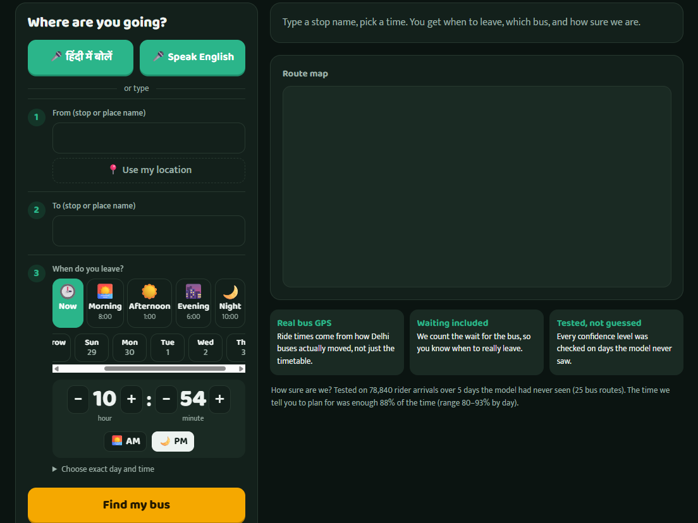
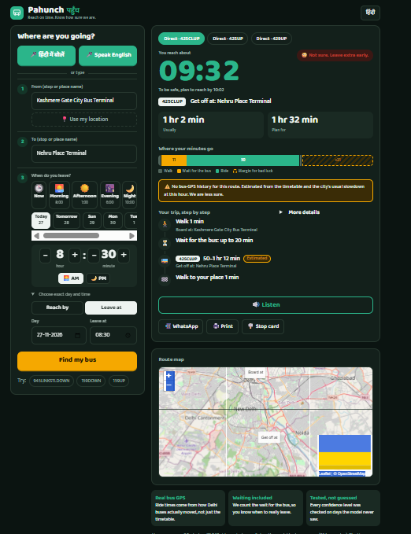
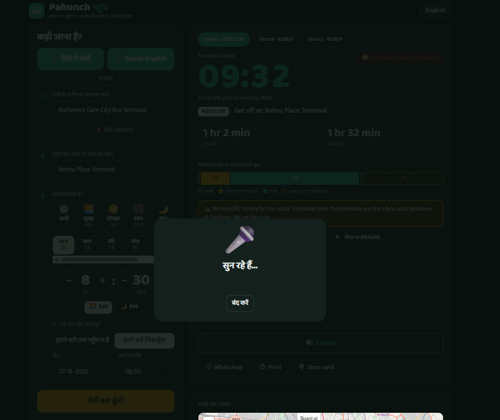
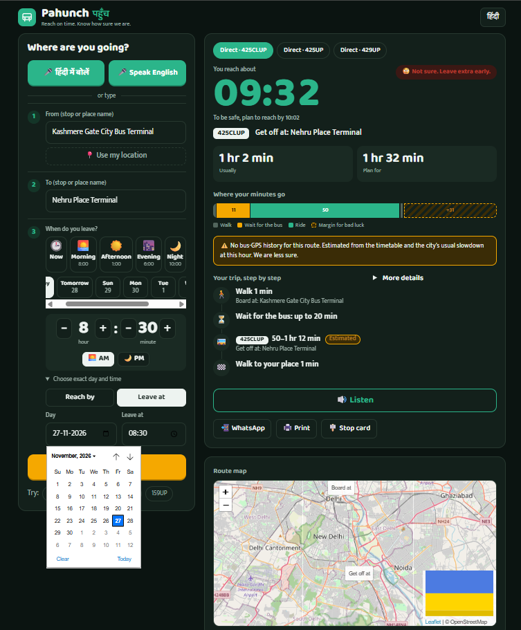
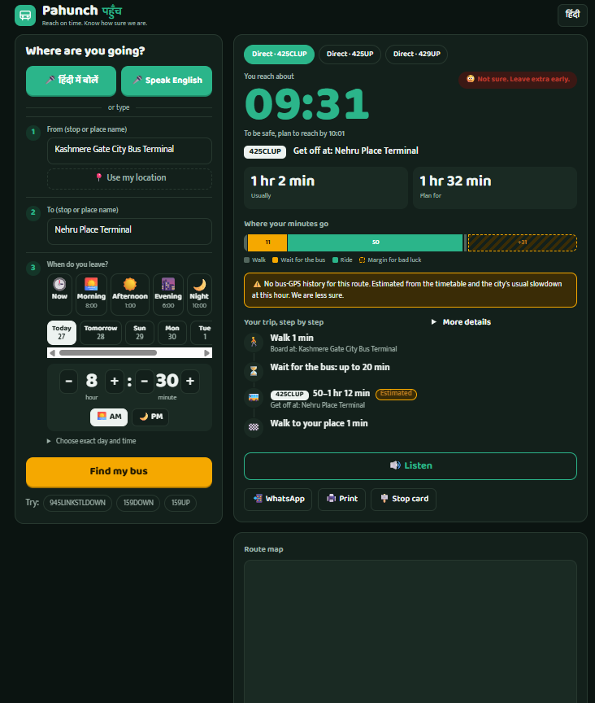
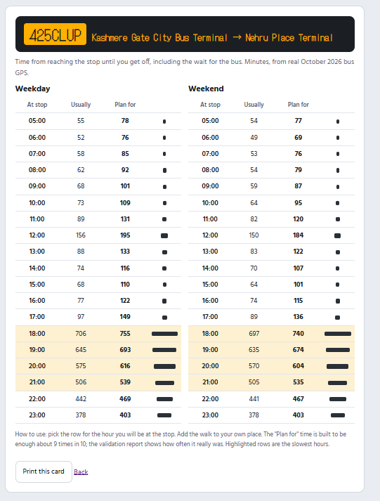

# Pahunch (पहुँच) — Reach on time. Know how sure we are.

**Transport Stack Hackathon 2026 · Phase 1 · Problem 1: real-time bus traffic model + journey planner API**
Author: Thriveni Reddicherla · Technical note: `Pahunch_Technical_Note.pdf`

Most apps give one number ("35 min"). Pahunch answers the question a commuter really has:
**"When must I leave to reach by 9:30?"** It counts the **wait for the bus**, measures ride time from **real bus movement**, and says **how sure it is**, with a confidence level that was **tested on days the model never saw**.

## Screenshots
| Plan a trip | Answer with journey ribbon | Voice for non-readers |
|---|---|---|
|  |  |  |

| Pick the time with pictures | Offline mode | Stop card / SMS |
|---|---|---|
|  |  |  |

## How it fits together
**1 Data in** (DTC bus GPS + GTFS) → **2 Learn** (snap pings to routes, time each stop pass, learn ride + wait spreads by hour and day type, learn a safety margin) → **3 Answer** (find stops, direct + one change, simulate wait + ride, leave-by + confidence) → **4 Reach everyone** (API, screen + map, voice, SMS, stop card, offline pack). Full diagram: `Pahunch_Technical_Note.pdf`.

## Results (days the model never saw)
| Test day | Ride-time error (min) | "Plan for" was enough |
|---|---|---|
| 8 Oct | 3.43 | 89% |
| 9 Oct | 3.24 | 91% |
| 12 Oct | 3.67 | 80% |
| 13 Oct | 3.64 | 93% |
| 14 Oct | 3.25 | 89% |
| **5 days, 78,840 trips** | **3.45** | **88%** (80–93%) |

- Timetable error averages 5.93 min and the all-day average 4.80 min, so Pahunch is lower on every day.
- 14 Oct (25 routes, 15,770 trips): plan enough at 8:00 95%, 13:00 84%, 18:00 86%, 22:00 89%.
- **Routes without GPS:** a city-wide speed "pulse" learned from GPS routes scales their timetable. Hiding one route at a time: 90% coverage vs 49% for the raw timetable, error 6.19 → 5.37 min. These answers are always marked *estimated* with low confidence.
- **Change of bus:** `python -m leavewise.validate_transfers` replays real two-bus trips on a held-out day and writes `transfer_report.md`.
- **Google Maps:** it cannot show past dates, so this is a sanity check only: 13 trips, 8 within 12 min.
- **Live check:** we replayed a past day with a live-position adjustment and saw no gain, so it is off by default. There is no live bus feed in this prototype.

## What is different
1. **Leave-by, not just duration.** Wait + ride are simulated together; the plan uses the 90th percentile plus a learned safety margin.
2. **Honest confidence.** 🙂 / 😐 / 😟 from data volume and spread, each with a measured on-time rate.
3. **One table, many doors.** The same table feeds the API, the screen, a printable stop card, a 160-character SMS and an operator view.
4. **For people who cannot read.** Speak start and destination in Hindi or English, hear the answer, confirm with ✔ / ✘; picture time buttons, exact-time clock, week strip, "use my location".
5. **Offline.** "Pocket Pahunch" plans direct trips on the phone from a downloaded pack; `/selftest.html` compares it with the server.
6. **Sells nothing.** No tickets, payments or login; no personal data kept.

## Method in short
- GPS `route_id` matches GTFS `route_id`. Each bus's pings are projected onto its GTFS route line (numpy), noise removed: duplicates, pings >80 m off the line, speed jumps >108 km/h, backward movement.
- Stop pass times are interpolated; passes across gaps >240 s or >1.5 km are **discarded, not guessed**.
- Ride and wait spreads per route-direction, stop pair, hour (±1 h) and day type. Wait comes from observed gaps between buses.
- Fallback ladder when data is thin: same hour & day type → same day type → all days → timetable × city pulse → distance at 14 km/h. The level used is returned as `basis`.
- Coverage: 26 routes with GPS history measured; all 2,497 route-directions (6,845 stops) answerable.

## Run it
Python 3.11. In the project folder:
```
pip install -r requirements.txt
python -m leavewise.app --data data --passes passes
```
Open **http://127.0.0.1:8000** in Chrome (voice needs Chrome and internet). Tests: `python -m pytest -q tests`.

Optional steps:
```
python -m leavewise.export_pack --data data --passes passes                      # offline pack
python -m leavewise.validate --data data --passes passes --holdout 2026-10-14   # validation_report.md
python -m leavewise.validate_transfers --data data --passes passes --holdout 2026-10-14
python -m leavewise.pulse --data data --passes passes                            # city pulse
python -m leavewise.network_prep --gtfs GTFS_DIR --out data                      # all-route network
```
Raw GPS `.db` files are not in this repo; `data/` and `passes/` hold the processed results.

## API
| Endpoint | Purpose |
|---|---|
| `GET /api/journeys?from=LAT,LNG&to=LAT,LNG&date=2026-10-14&arrive_by=09:30` | options: `leave_by`, walk, boarding stop, route, alight stop, transfers, typical and plan-for minutes, `confidence`, `n_observations`, `basis`, `on_time_rate`, `measured` |
| same with `&depart=08:30` | arrival-time options |
| `/api/search?q=` | stop-name search |
| `/api/voice_match` | match a spoken name (Hindi or English) to stops |
| `/api/sms` | ≤160-character answer (`lang=hi` for Hindi) |
| `/api/card`, `/api/operator` | printable stop card; route × hour reliability |
| `/api/shape`, `/api/stops`, `/api/examples`, `/api/health`, `/pack.json` | support |

`from` / `to` also accept `stop:<stop_id>` or a stop name.

## Where it grows next
Live feed blended for the next bus; GPS history for more routes (lifts "estimated" answers to measured); more than one change; SMS/IVR for feature phones; reliability scores for operators; any city with GTFS + GPS can reuse it.

## Credits
pandas, numpy, Flask, Leaflet + OpenStreetMap. Data: Delhi Transport Stack (JICA / Chartr / IIIT Delhi).
